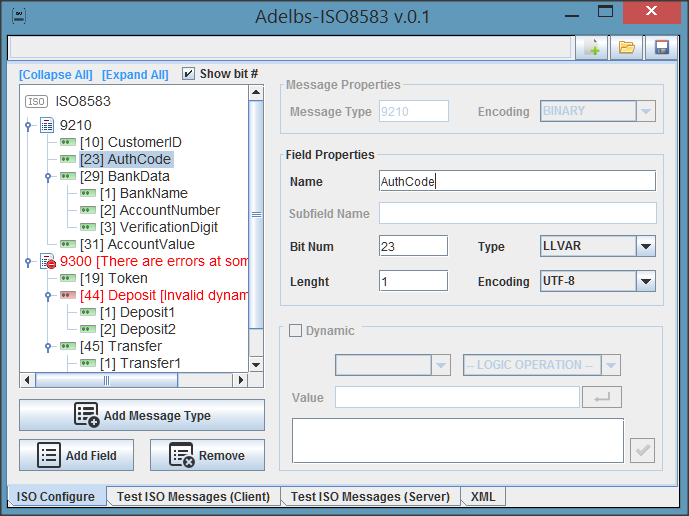
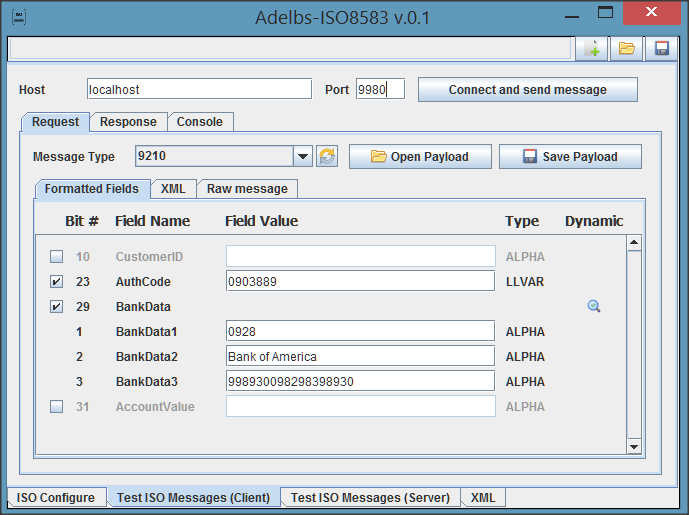
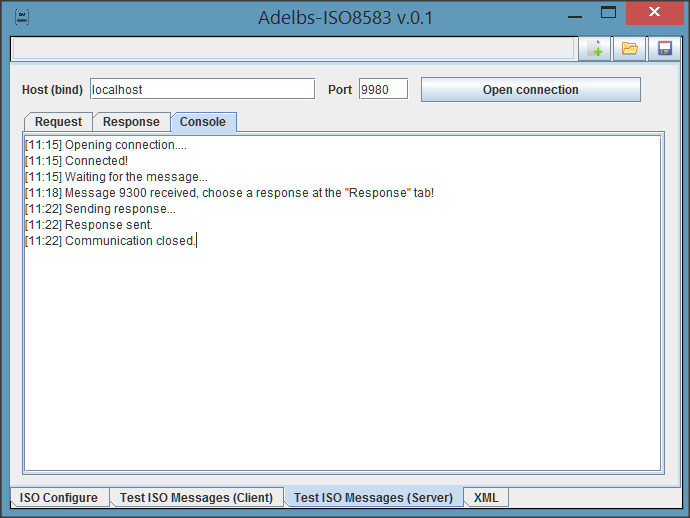
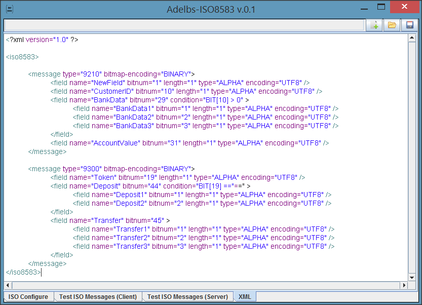

*Este proyecto no se mantiene activamente, por lo que puede tardar un tiempo en responder a los Issues.*

*Jul-2020: Pronto actualizaré la wiki y enviaré algunas actualizaciones.*

# Adelbs-ISO8583
Esta es una herramienta GUI para probar el protocolo ISO8583 (solicitudes y respuestas), y también una biblioteca en Java.
Mediante esta herramienta puedes:
* Configurar la estructura ISO8583 tanto de forma visual (UI) como en un archivo XML muy sencillo;
* Invocar un servicio ISO8583, enviando mensajes según el archivo de configuración XML;
* Recibir un mensaje ISO8583 desde un servicio externo y parsearlo a un formato legible;
* Parsear y analizar mensajes.

Los mensajes pueden estar en muchos formatos de codificación, incluyendo EBCDIC de mainframe.

Se encuentra en desarrollo (aún no lanzado), por lo que es posible que encuentres algunos errores de UI. 

Por favor:
* Abre nuevos Issues si encuentras algún error o si tienes sugerencias.
* Visita la Wiki (está en construcción).

 

 
